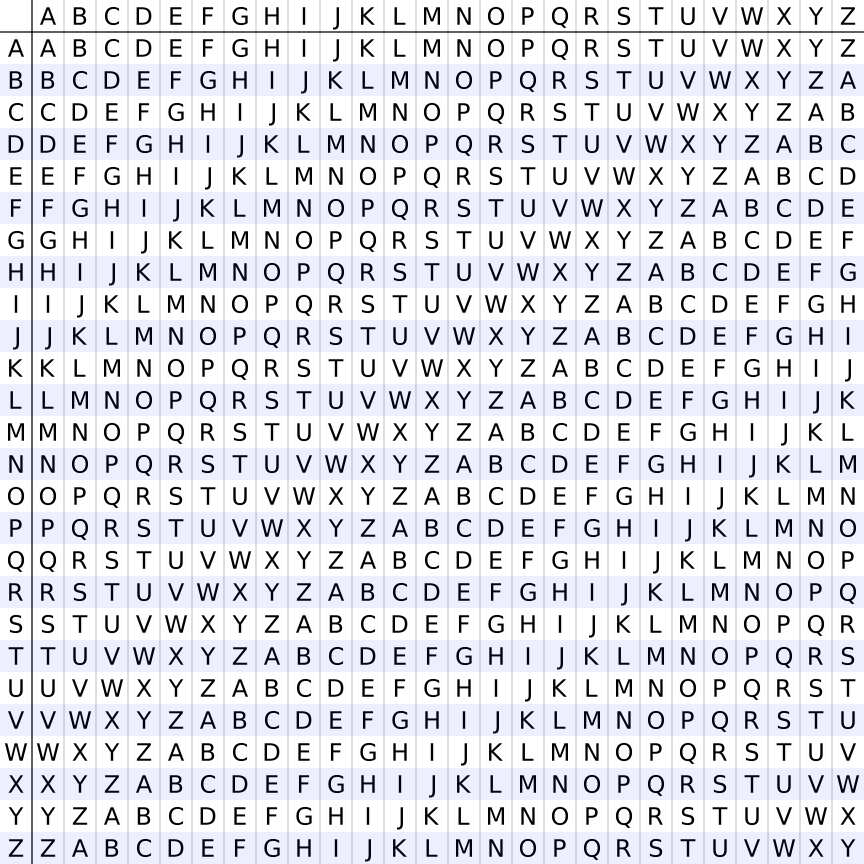

#+title: Cryptography

This project contains multiple parts. While I first learned of these ciphers independently, the code is based on Al Sweigart's versions in [[https://inventwithpython.com/hacking/chapters/][Cracking Codes with Python]]. I updated the code to use f-strings and functions. The first part is the classic Caesar cipher. The second is a Caesar cipher hacker. The third is the Vigenère cipher.

* Sequence

1. Mastermind: students play [[https://www.archimedes-lab.org/mastermind.html][online]] and complete the strategy worksheet. The [[https://docs.google.com/document/d/1ey6HbULuq6auPDZvFxymyz4MovhVOyyKkjkNI2Tf-OM/edit][Google Doc]] is the version assigned in Canvas, and [[file:mastermind_strategy.org][mastermind_strategy.org]] is the same worksheet in Org.
2. [[file:bagels.org][Bagels]]: the same game with digits, written in Python.
3. The Caesar Cipher on Paper ([[https://docs.google.com/document/d/1V5edr17a1k-WvTKF22D4XQOZ16bOhjKwL8XhvAkdYGY/edit][Google Doc]] for Canvas, [[file:caesar_cipher_practice.org][Org source]]), then the Caesar cipher in Python. Breaking the cipher is saved for a later activity.
4. Caesar hacker.
5. [[file:vigenere_cipher_practice.org][The Vigenère Cipher on Paper]], which students do with a printed copy of the , then the Vigenère cipher in Python.

Answer keys for all three worksheets are in [[file:answer_keys.org][answer_keys.org]].

* Caesar Cipher

The Caesar cipher uses the Python ~if __name__ == "__main__"~ idiom. Hopefully this will help students get more comfortable with it. It also provides an opportunity for students to see the similarities between the Caesar cipher and the Vigenère cipher. When refactored in this manner, we can reuse the =main()=, =get_mode()=, =get_message()=, and =print_message()= functions unchanged.

** Files

- [[file:caesar_cipher.py][caesar_cipher.py]]
- [[file:caesar_cipher_template.py][caesar_cipher_template.py]]
- [[https://colab.research.google.com/drive/1f8Ah9Yq0mEBNcjCdLoJ2brWdXHh9MOeU][Colab template]]

** Code

*** Setup

#+begin_src python :tangle caesar_cipher.py
"""Encrypt and decrypt messages with the Caesar cipher."""

LETTERS = "ABCDEFGHIJKLMNOPQRSTUVWXYZ"

#+end_src

*** =main()=

=main()= reads like an outline of the program. Each line hands one job to one function.

#+begin_src python :tangle caesar_cipher.py
def main() -> None:
    """Run the Caesar cipher program."""
    mode = get_mode()
    key = get_key()
    message = get_message(mode)
    translated_message = translate_message(mode, key, message)
    print_message(mode, translated_message)

#+end_src

*** =get_mode()=

#+begin_src python :tangle caesar_cipher.py
def get_mode() -> str:
    """Ask the user for the mode and return "encrypt" or "decrypt"."""
    while True:
        print("Do you want to (e)ncrypt or (d)ecrypt?")
        response = input("> ").lower()
        if response.startswith("e"):
            mode = "encrypt"
            break
        elif response.startswith("d"):
            mode = "decrypt"
            break
        print("Please enter the letter e or d.")
    return mode

#+end_src

*** =get_key()=

A key of 0 is allowed. It leaves the message unchanged, which is worth letting students discover.

#+begin_src python :tangle caesar_cipher.py
def get_key() -> int:
    """Ask the user for the key and return it as an integer."""
    max_key = len(LETTERS) - 1
    while True:
        print(f"Please enter the key (0 to {max_key}) to use.")
        response = input("> ")
        if response.isdecimal() and int(response) <= max_key:
            key = int(response)
            break
        print(f"The key must be a whole number from 0 to {max_key}.")
    return key

#+end_src

*** =get_message()=

#+begin_src python :tangle caesar_cipher.py
def get_message(mode: str) -> str:
    """Ask the user for the message and return it in uppercase."""
    print(f"Enter the message to {mode}.")
    message = input("> ").upper()
    return message

#+end_src

*** =translate_message()=

This is the cipher. The modulo operator handles the wrap-around in both directions: past Z when encrypting and before A when decrypting.

#+begin_src python :tangle caesar_cipher.py
def translate_message(mode: str, key: int, message: str) -> str:
    """Return the message encrypted or decrypted with the key."""
    translated = ""
    for symbol in message:
        if symbol in LETTERS:
            idx = LETTERS.find(symbol)
            if mode == "encrypt":
                new_idx = (idx + key) % len(LETTERS)
            elif mode == "decrypt":
                new_idx = (idx - key) % len(LETTERS)
            translated += LETTERS[new_idx]
        else:
            # Spaces, numbers, and punctuation are not changed.
            translated += symbol
    return translated

#+end_src

*** =print_message()=

#+begin_src python :tangle caesar_cipher.py
def print_message(mode: str, translated_message: str) -> None:
    """Print the mode and the translated message."""
    print(f"{mode.title()}ed message:")
    print(translated_message)

#+end_src

*** Run

#+begin_src python :tangle caesar_cipher.py
if __name__ == "__main__":
    main()

#+end_src

* Caesar Hacker

The Caesar cipher only has 26 possible keys, so the hacker simply tries all of them and lets a human pick out the one that reads as English. This is a brute-force attack. The hacker reuses =translate_message()= from the Caesar cipher without changing a character, which is the payoff for having written it as a function. The only new code is a loop.

** Files

- [[file:caesar_hacker.py][caesar_hacker.py]]
- [[file:caesar_hacker_template.py][caesar_hacker_template.py]]
- [[https://colab.research.google.com/drive/1rEDfWHtq0-8OP6m2kXPsLzzP3JHeKWm-][Colab template]]

** Code

*** Setup

#+begin_src python :tangle caesar_hacker.py
"""Hack the Caesar cipher by trying every possible key (brute force)."""

LETTERS = "ABCDEFGHIJKLMNOPQRSTUVWXYZ"

#+end_src

*** =main()=

#+begin_src python :tangle caesar_hacker.py
def main() -> None:
    """Run the Caesar hacker program."""
    message = get_message()
    hack_message(message)

#+end_src

*** =get_message()=

#+begin_src python :tangle caesar_hacker.py
def get_message() -> str:
    """Ask the user for the encrypted message and return it in uppercase."""
    print("Enter the encrypted Caesar cipher message to hack.")
    message = input("> ").upper()
    return message

#+end_src

*** =translate_message()=

Copied from the Caesar cipher.

#+begin_src python :tangle caesar_hacker.py
def translate_message(mode: str, key: int, message: str) -> str:
    """Return the message encrypted or decrypted with the key."""
    translated = ""
    for symbol in message:
        if symbol in LETTERS:
            idx = LETTERS.find(symbol)
            if mode == "encrypt":
                new_idx = (idx + key) % len(LETTERS)
            elif mode == "decrypt":
                new_idx = (idx - key) % len(LETTERS)
            translated += LETTERS[new_idx]
        else:
            # Spaces, numbers, and punctuation are not changed.
            translated += symbol
    return translated

#+end_src

*** =hack_message()=

#+begin_src python :tangle caesar_hacker.py
def hack_message(message: str) -> None:
    """Print the message decrypted with every possible key."""
    for key in range(len(LETTERS)):
        translated_message = translate_message("decrypt", key, message)
        print(f"Key #{key}: {translated_message}")

#+end_src

*** Run

#+begin_src python :tangle caesar_hacker.py
if __name__ == "__main__":
    main()

#+end_src

* Vigenère Cipher

The Vigenère cipher uses a keyword instead of a number. Each letter of the keyword is its own Caesar key, and the message cycles through them. Only two functions differ from the Caesar cipher: =get_key()= returns a word, and =translate_message()= looks up a new shift for every letter. The template gives students =main()= and =get_mode()= because they have already written them.

** Files

- [[file:vigenere.py][vigenere.py]]
- [[file:vigenere_template.py][vigenere_template.py]]
- [[https://colab.research.google.com/drive/15j9hqgDl4vcTtD-B-b2pFcf-Y1S6F7Nq][Colab template]]

** Code

*** Setup

#+begin_src python :tangle vigenere.py
"""Encrypt and decrypt messages with the Vigenère cipher."""

from itertools import cycle
from string import ascii_uppercase

LETTERS = ascii_uppercase

#+end_src

*** =main()=

#+begin_src python :tangle vigenere.py
def main() -> None:
    """Run the Vigenère cipher program."""
    mode = get_mode()
    key = get_key()
    message = get_message(mode)
    translated_message = translate_message(mode, key, message)
    print_message(mode, translated_message)

#+end_src

*** =get_mode()=

#+begin_src python :tangle vigenere.py
def get_mode() -> str:
    """Ask the user for the mode and return "encrypt" or "decrypt"."""
    while True:
        print("Do you want to (e)ncrypt or (d)ecrypt?")
        response = input("> ").lower()
        if response.startswith("e"):
            mode = "encrypt"
            break
        elif response.startswith("d"):
            mode = "decrypt"
            break
        print("Please enter the letter e or d.")
    return mode

#+end_src

*** =get_key()=

#+begin_src python :tangle vigenere.py
def get_key() -> str:
    """Ask the user for the key and return it in uppercase."""
    while True:
        print("Please specify the key to use.")
        print("It can be a word or any combination of letters:")
        response = input("> ").upper()
        if response.isalpha():
            key = response
            break
        print("The key can only contain letters.")
    return key

#+end_src

*** =get_message()=

#+begin_src python :tangle vigenere.py
def get_message(mode: str) -> str:
    """Ask the user for the message and return it in uppercase."""
    print(f"Enter the message to {mode}.")
    message = input("> ").upper()
    return message

#+end_src

*** =translate_message()=

=cycle()= from =itertools= repeats the key forever, and =next()= asks it for one more letter. The key only advances when a letter is translated, so spaces and punctuation do not use up a key letter.

#+begin_src python :tangle vigenere.py
def translate_message(mode: str, key: str, message: str) -> str:
    """Return the message encrypted or decrypted with the key."""
    translated = []
    key_letters = cycle(key)
    for symbol in message:
        if symbol in LETTERS:
            idx = LETTERS.find(symbol)
            # Only move to the next key letter when a letter is translated.
            shift = LETTERS.find(next(key_letters))
            if mode == "encrypt":
                new_idx = (idx + shift) % len(LETTERS)
            elif mode == "decrypt":
                new_idx = (idx - shift) % len(LETTERS)
            translated.append(LETTERS[new_idx])
        else:
            # Spaces, numbers, and punctuation are not changed.
            translated.append(symbol)
    return "".join(translated)

#+end_src

*** =print_message()=

#+begin_src python :tangle vigenere.py
def print_message(mode: str, translated_message: str) -> None:
    """Print the mode and the translated message."""
    print(f"{mode.title()}ed message:")
    print(translated_message)

#+end_src

*** Run

#+begin_src python :tangle vigenere.py
if __name__ == "__main__":
    main()

#+end_src

*** Alternative =translate_message()= without =itertools=

=cycle()= and =next()= are new to students. This version does the same job with a counter and the modulo operator, which they will have just used for the wrap-around in the Caesar cipher. It is not tangled.

#+begin_src python :tangle no
def translate_message(mode: str, key: str, message: str) -> str:
    """Return the message encrypted or decrypted with the key."""
    translated = []
    key_idx = 0
    for symbol in message:
        if symbol in LETTERS:
            idx = LETTERS.find(symbol)
            # The modulo wraps key_idx back to the start of the key.
            shift = LETTERS.find(key[key_idx % len(key)])
            if mode == "encrypt":
                new_idx = (idx + shift) % len(LETTERS)
            elif mode == "decrypt":
                new_idx = (idx - shift) % len(LETTERS)
            translated.append(LETTERS[new_idx])
            key_idx += 1
        else:
            translated.append(symbol)
    return "".join(translated)
#+end_src

* Resources

** Videos

- [[https://youtu.be/fdKze86foTc][What is the Caesar Cipher and how to decipher it]] (Network Encyclopedia, 3:27). Note that it shows code for the cipher in several languages, including Python.
- [[https://www.khanacademy.org/computing/computer-science/cryptography/crypt/v/caesar-cipher][The Caesar cipher]] (Khan Academy, Journey into Cryptography). Ends with frequency analysis.
- [[https://www.khanacademy.org/computing/computer-science/cryptography/crypt/v/polyalphabetic-cipher][Polyalphabetic cipher]] (Khan Academy, 2:27). Why a shift word hides the patterns a single shift leaves behind.

** Reading and Interactive Tools

- [[https://simonsingh.com/The_Black_Chamber/caesar.html][The Black Chamber: Caesar cipher]] and the [[https://simonsingh.com/The_Black_Chamber/vigenere_square_tool.html][Vigenère square tool]] from Simon Singh, author of /The Code Book/. The [[https://simonsingh.net/The_Black_Chamber/vigenere_cracking.html][cracking the Vigenère cipher]] page is a good extension.
- [[https://curriculum.code.org/csp-19/unit4/8/][Code.org CSP: Encryption with Keys and Passwords]]. An older Code.org lesson built around a Vigenère widget, with a student worksheet.
- [[https://inventwithpython.com/hacking/chapters/][Cracking Codes with Python]] by Al Sweigart, free to read online. Chapter 1 makes paper cipher tools, chapters 5 and 6 are the Caesar cipher and its brute-force hack, and chapter 18 is the Vigenère cipher.

** Printable Handouts

- [[file:caesar_cipher_practice.org][The Caesar Cipher on Paper]] and [[file:vigenere_cipher_practice.org][The Vigenère Cipher on Paper]]. Written for this unit. The Caesar handout treats letters as indexes 0 to 25 so the paper method matches the code. The Vigenère handout uses the square and leaves the arithmetic for students to work out.
- . The Vigenère square from Derek Babb's lesson, credited there to Brandon T. Fields (cdated), based on Vigenere-square.png by Matt Crypto and an Inkscape version by bdesham.
- [[https://math.colorado.edu/~kstange/teaching-resources/crypto/vig-square.pdf][Vigenère square]] (Katherine Stange, CU Boulder). A one-page printable square with row numbers.
- [[https://derekbabb.github.io/CyberSecurity/Classic_Cryptography/Vigenere_Cipher.html][The Vigenère cipher lesson]] (Derek Babb). The source of the square, and of the open-ended activity that the Vigenère handout's layout is modeled on.
